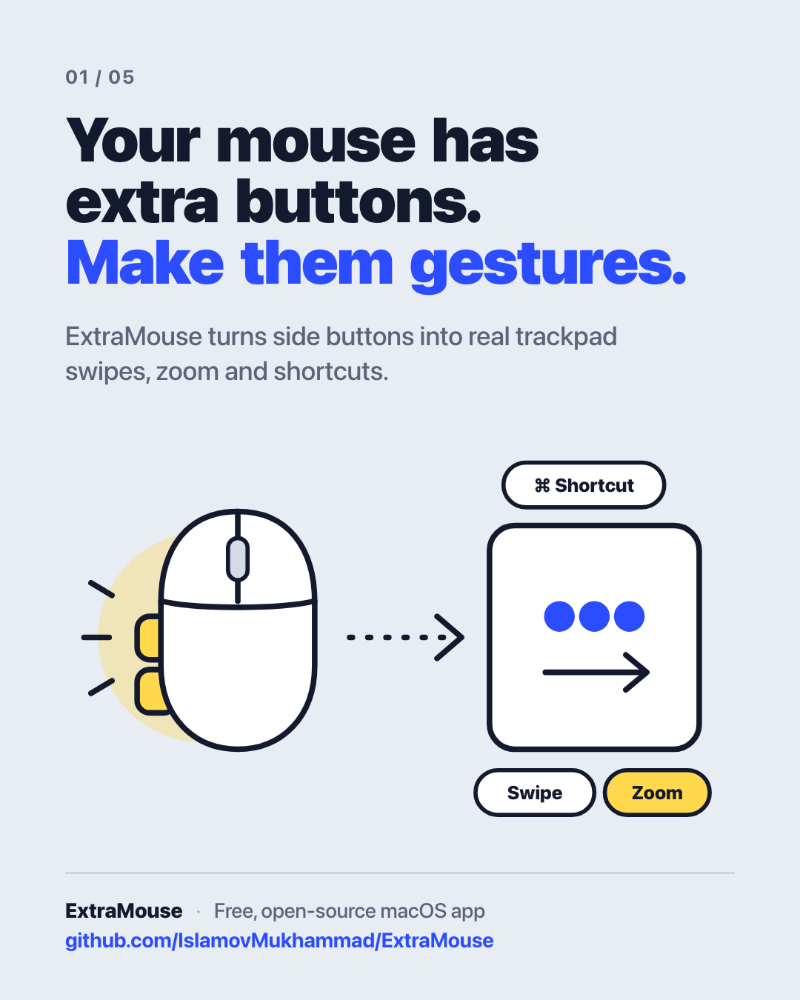

<p align="center">
  
</p>

# ExtraMouse

[](https://github.com/IslamovMukhammad/ExtraMouse/actions/workflows/ci.yml)

**Turn the extra buttons on any mouse into real trackpad gestures on macOS.**

Free, open-source menu-bar app. Native SwiftUI, ~0% CPU when idle.

## Features

- **Hold + drag** → a real three-finger trackpad swipe. Switch Spaces, open Mission Control or App Exposé — the animation follows your hand and finishes with trackpad-like momentum.
- **Hold + scroll** → smooth zoom (a real pinch-magnify event), switch Spaces, or change the volume.
- **Click** a side button → any action: volume, brightness, media keys, Mission Control, App Exposé, Launchpad, Show Desktop, switch Space, Look Up, Smart Zoom, Back / Forward, Middle Click, any keyboard shortcut, or open any app.
- **Double-click** and **hold** triggers — every button gets its own action for click, double-click, hold, drag and scroll.
- **Drag to scroll** with momentum.
- Works with any mouse that has extra buttons (Button 3 = middle, 4, 5, 6, …). Add a button by hovering **+** and pressing it.
- Sensitivity slider (0.4–2.5), reverse direction, and a keyboard-shortcut fallback when fluid gestures are off.
- **Scrolling** tab: reverse scrolling, Shift → horizontal scroll, Cmd → zoom.
- Built-in shortcut recorder; the cursor stays still while a gesture is running.
- Launch at login, and an option to hide the menu-bar icon (open the app again to get to Settings).
- Native SwiftUI + Liquid Glass, lives in the menu bar.

### Defaults

| Button | Click | Drag | Scroll |
|---|---|---|---|
| Button 4 | Volume Down | Spaces & Mission Control (left/right = Space, up = Mission Control, down = App Exposé) | Switch Spaces |
| Button 5 | Volume Up | Drag to Scroll | Zoom |

## Requirements

- macOS 26 or later (tested on macOS 27), Apple silicon
- Accessibility permission (asked on first launch)
- Xcode 26 / Swift 6 toolchain to build

## Build from source

There is no prebuilt download — build it yourself in a minute:

```bash
git clone https://github.com/IslamovMukhammad/ExtraMouse.git
cd ExtraMouse
./build.sh --install   # builds, copies to /Applications and launches
```

`./build.sh` alone puts the app in `build/ExtraMouse.app`. Run the tests with `swift test`.

If you have no Apple signing certificate the app is signed ad-hoc; macOS may then ask you to re-grant
Accessibility permission after every rebuild.

> **Note:** If you also use Mac Mouse Fix, Logi Options+, BetterTouchTool or similar, turn them off —
> two apps intercepting the same buttons will fight each other.

## How it works

| Part | File |
|---|---|
| Event tap on its own high-priority thread | `Sources/ExtraMouse/Engine/EventTapController.swift` |
| Pure, unit-tested gesture state machine | `Sources/ExtraMouse/Engine/GestureEngine.swift` |
| Trackpad (Dock) swipe synthesis | `Sources/ExtraMouse/Output/DockSwipe.swift` |
| Keys, media keys, scroll & zoom events | `Sources/ExtraMouse/Output/EventPoster.swift` |
| Settings UI | `Sources/ExtraMouse/UI/` |

Fluid gestures use private macOS event fields (looked up at runtime, never linked). If a future macOS
breaks them, turn off **Buttons › Options… › Fluid Gestures** to fall back to plain keyboard shortcuts.

## Known limitations

- Fluid gestures have not yet been verified end-to-end on every mouse. If a swipe goes the wrong way, turn on **Buttons › Options… › Reverse Drag Direction**, or turn off **Fluid Gestures** there.
- Only tested on macOS 27. The macOS 26 code path is untested.
- Apple silicon (arm64) only.
- Shift → horizontal scroll may double-convert on some mice.
- Not notarized; ad-hoc builds may need Accessibility re-granted after each rebuild.
- English UI only. No per-app profiles, smooth scrolling or auto-update — by design.

Bug reports and pull requests are welcome.

## Credits

Inspired by [Mac Mouse Fix](https://github.com/noah-nuebling/mac-mouse-fix) by Noah Nuebling. ExtraMouse
is an independent implementation and contains no Mac Mouse Fix code.

## License

[MIT](LICENSE) © 2026 Muhammad Islamov

## Follow

- GitHub: [@IslamovMukhammad](https://github.com/IslamovMukhammad)
